|角色|名字|职业|等级|血大|经验|攻击|技术|速度|幸运|防御|魔法|道具|魔防|移动|血小|
|---|---|---|---|---|---|---|---|---|---|---|---|---|---|---|---|
|1|67AE|67AF|67B0|67B1|67B2|67B3|67B4|67B5|67B6|67B7|67B8|67B9|67BA|67BB|67BC|
|2|67C3|67C4|67C5|67C6|67C7|67C8|67C9|67CA|67CB|67CC|67CD|67CE|67CF|67D0|67D1|
|3|67D8|67D9|67DA|67DB|67DC|67DD|67DE|67DF|67E0|67E1|67E2|67E3|67E4|67E5|67E6|
|4|67ED|67EE|67EF|67F0|67F1|67F2|67F3|67F4|67F5|67F6|67F7|67F8|67F9|67FA|67FB|
|5|6802|6803|6804|6805|6806|6807|6808|6809|680A|680B|680C|680D|680E|680F|6810|
|6|6817|6818|6819|681A|681B|681C|681D|681E|681F|6820|6821|6822|6823|6824|6825|
|7|682C|682D|682E|682F|6830|6831|6832|6833|6834|6835|6836|6837|6838|6839|683A|
|8|6841|6842|6843|6844|6845|6846|6847|6848|6849|684A|684B|684C|684D|684E|684F|
|9|6856|6857|6858|6859|685A|685B|685C|685D|685E|685F|6860|6861|6862|6863|6864|
|10|686B|686C|686D|686E|686F|6870|6871|6872|6873|6874|6875|6876|6877|6878|6879|
|11|6880|6881|6882|6883|6884|6885|6886|6887|6888|6889|688A|688B|688C|688D|688E|
|12|6895|6896|6897|6898|6899|689A|689B|689C|689D|689E|689F|68A0|68A1|68A2|68A3|
|13|68AA|68AB|68AC|68AD|68AE|68AF|68B0|68B1|68B2|68B3|68B4|68B5|68B6|68B7|68B8|
|14|68BF|68C0|68C1|68C2|68C3|68C4|68C5|68C6|68C7|68C8|68C9|68CA|68CB|68CC|68CD|
|15|68D4|68D5|68D6|68D7|68D8|68D9|68DA|68DB|68DC|68DD|68DE|68DF|68E0|68E1|68E2|
|16|68E9|68EA|68EB|68EC|68ED|68EE|68EF|68F0|68F1|68F2|68F3|68F4|68F5|68F6|68F7|
|17|68FE|68FF|6900|6901|6902|6903|6904|6905|6906|6907|6908|6909|690A|690B|690C|
|18|6913|6914|6915|6916|6917|6918|6919|691A|691B|691C|691D|691E|691F|6920|6921|
|19|6928|6929|692A|692B|692C|692D|692E|692F|6930|6931|6932|6933|6934|6935|6936|
|20|693D|693E|693F|6940|6941|6942|6943|6944|6945|6946|6947|6948|6949|694A|694B|
----
| 日文名称 | 代码 | 中文译名 | 攻 | 防 | 命中 | 必杀 | 射程 | 重量 | 回复 | 备注 |
| ---- | ---- | ---- | ---- | ---- | ---- | ---- | ---- | ---- | ---- | ---- |
| つるぎ |-| 剑 | 0|-|90|0|1|0|-| 基本武器 |
| はがねのつるぎ | 12,0B(16) | 钢剑 | 4|-|80|0|1|1|-|-|
| ぎんのつるぎ | 13,0C(16) | 银剑 | 8|-|90|0|1|1|-|-|
| ゆうしゃのけん | 14,0D(16) | 勇者之剑 | 5|-|100|30|1|0|-| 非常容易发出必杀一击 |
| あんこくのけん | 15,0E(16) | 暗黑之剑 | 13|-|70|0|1|5|-| 运气低的话自身受伤害 |
| いかづちのけん | 16,0F(16) | 雷之剑 | 80|-|0|-|1-2|3|-| 直接、间接攻击力都为 15 (魔法攻击)|
| せいなるつるぎ | 10 | 神圣剑 | 3|-|100|15|1|0|0 | 对魔兽系敌人有特效 |
| おうけのつるぎ | 18,12(16) | 王家之剑 | 7|-|100|20|1|0|0 | 阿鲁姆专用 |
| ファルシオン | 17,11(16) | 圣剑・法尔西昂 | 10|-|80|0|1|0|0 | 阿鲁姆专用，对魔兽特效，可攻击 HP52 以下邪神 |
----
| 日文名称 | 代码 | 中文译名 | 攻 | 防 | 命中 | 必杀 | 射程 | 重量 | 回复 | 备注 |
| ---- | ---- | ---- | ---- | ---- | ---- | ---- | ---- | ---- | ---- | ---- |
| やり |-| 枪 |-|-|90|0|1|0|-|-|
| はがねのやり | 2 | 钢枪 | 4|-|80|0|1|1|-|-|
| ぎんのやり | 3 | 银枪 | 8|-|90|0|1|1|-|-|
| てやり | 4 | 投枪 | 3|-|70|0|1-2|2|-|-|
| ナイトキラー | 6 | 骑士杀手 | 3|-|85|0|1|1|-| 对骑士系有特效 |
| せいなるやり | 5 | 神圣枪 | 3|-|90|10|1|0|0 | 对魔兽系有特效 |
| グラディウス | 07 | 圣枪・古拉迪乌斯 | 15|-|100|0|1-2|0|0|Gladius|
| りゅうせい | 08 | 流星 | 10|-|100|50|1|0|0 | 石像鬼掉落，必杀率极高 |
| げっこう | 11,0A(16) | 月光 | 10|-|100|0|1|1|0 | 魔神掉落，对手地形效果无效 |
| たいよう | 09 | 太阳 | 20|-|80|0|1|2|0 | 眼球怪掉落，杀伤力最强 |
----
| 日文名称 | 代码 | 中文译名 | 攻 | 防 | 命中 | 必杀 | 射程 | 重量 | 回复 | 备注 |
| ---- | ---- | ---- | ---- | ---- | ---- | ---- | ---- | ---- | ---- | ---- |
| ゆみ |-| 弓 |-|-|-|-|-|-|-| 射程均为 5|
| はがねのゆみ | 20 | 钢弓 | 3|-|70|0|5|-|-| 速度降低 1|
| ぎんのゆみ | 22 | 银弓 | 7|-|90|0|5|-|-| 速度降低 2|
| せいなるゆみ | 21,15(16) | 圣弓 | 5|-|95|50|5|-|0 | 高必杀，每回合回 HP5，对怪物增伤 |
----
| 日文名称 | 代码 | 中文译名 | 攻 | 防 | 命中 | 必杀 | 射程 | 重量 | 回复 | 备注 |
| ---- | ---- | ---- | ---- | ---- | ---- | ---- | ---- | ---- | ---- | ---- |
| たて |-| 盾 |-|-|-|-|-|-|-|-|
| かわのたて | 48 | 皮盾 |-|3|-|-|-|-|-|-|
| はがねのたて | 49 | 钢盾 |-|5|-|-|-|-|-|-|
| ぎんのたて | 50 | 银盾 |-|7|-|-|-|-|-|-|
| せいなるたて | 51 | 圣盾 |-|0|-|-|-|-|0 | 对怪防御上升，每回合回 HP5|
| りゅうのたて | 53 | 龙盾 |-|13|-|-|-|-|0 | 提升魔防，每回合回 HP5|
| まふうじのたて | 52 | 封魔盾 |-|0|-|-|-|-|-| 敌人无法对持有者放魔法 |
----
| 日文名称 | 代码 | 中文译名 | 攻 | 防 | 命中 | 必杀 | 射程 | 重量 | 回复 | 备注 |
| ---- | ---- | ---- | ---- | ---- | ---- | ---- | ---- | ---- | ---- | ---- |
| ゆびわ |-| 戒指 |-|-|-|-|-|-|-| 全部每回合自动回复 HP5|
| せいなるゆびわ | 54 | 神圣戒指 |-|-|-|-|-|-|0|-|
| てんしのゆびわ | 55 | 天使戒指 |-|-|-|-|-|-|0 | 运气固定 40，升级全属性 + 2|
| まどうのゆびわ | 57,39(16) | 魔道戒指 |-|-|-|-|-|-|0 | 魔法射程 5|
| はやさのゆびわ | 56 | 速度戒指 |-|-|-|-|-|-|0 | 速度固定 40，移动 + 5|
| いのりのゆびわ | 58 | 祈祷戒指 |-|-|-|-|-|-|0 | 危急时闪避伤害 |
----
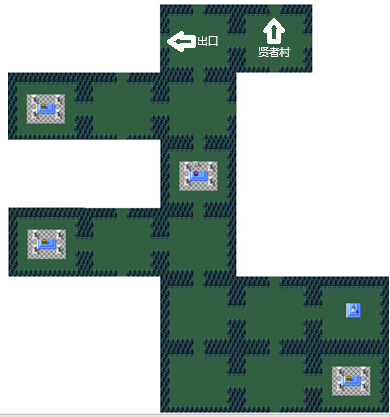
----

  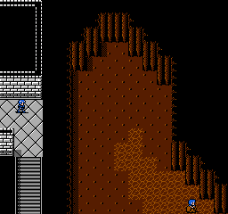
  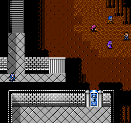
  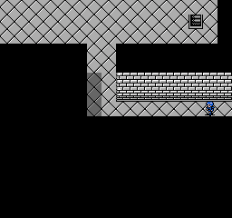
  
  
  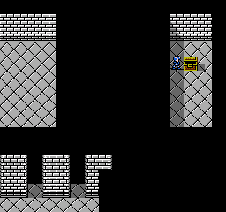
  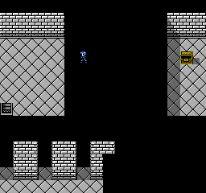
  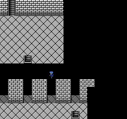
  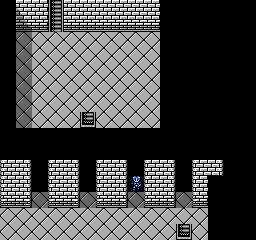
  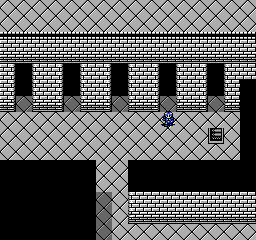
  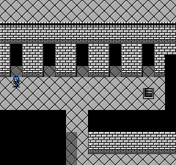
  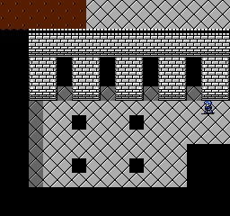
  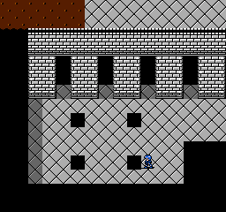
  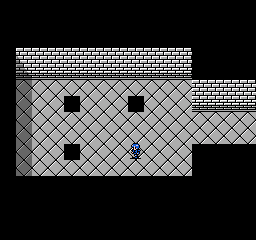
  
  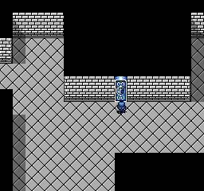
  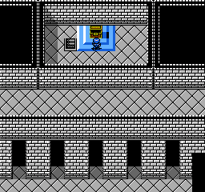
  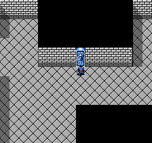
  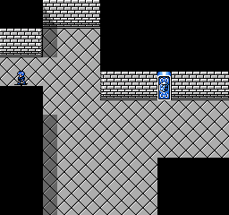
  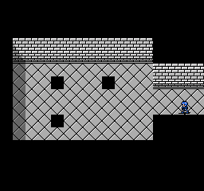
  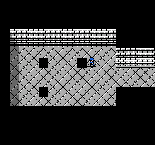
  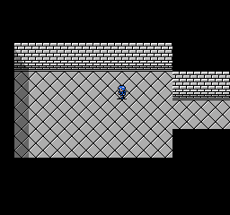
  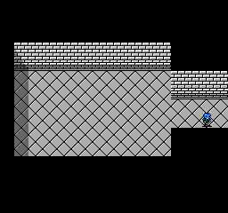
  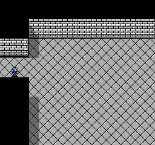
  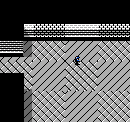
  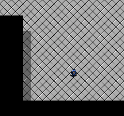
  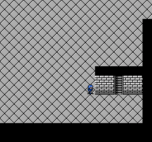
  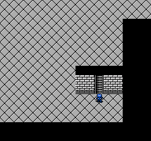
  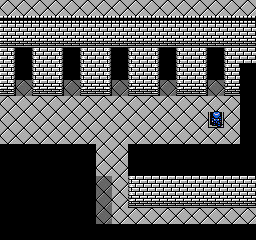
  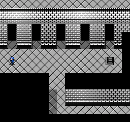
  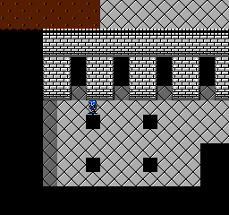
  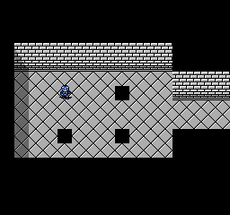
  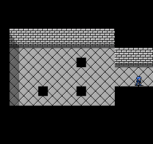
  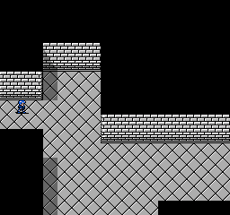
  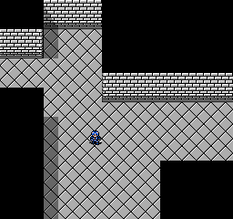
  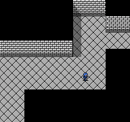
  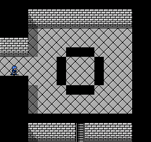
  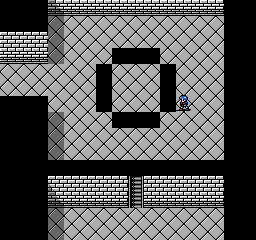
  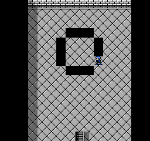
  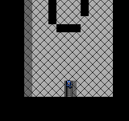
  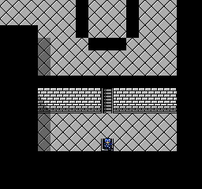
  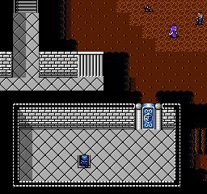
  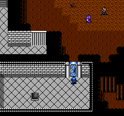

